# Resumo {.unnumbered}

Este trabalho implementa um sistema que recomenda materiais didáticos combinando três fontes: **filtragem por conteúdo** (metadados dos materiais × perfil do aluno), **filtragem colaborativa** (fatoração de matrizes treinada por ALS sobre o histórico de avaliações) e um **modelo baseado em conhecimento** (regras de pré-requisitos, nível e currículo). Um híbrido de quatro etapas pondera as três pontuações, troca os pesos conforme o que se sabe do aluno (*cold start*), aplica restrições de pré-requisito e diversifica a lista com MMR.

A análise dos dados fornecidos mostrou que as interações **não contêm sinal aprendível**: só % delas ligam um aluno e um material cadastrados, todas as colunas são uniformes e nem o aluno, nem o material, nem a combinação perfil × obra influenciam a nota (13 testes estatísticos, @sec-dados). Nesses dados, todos os modelos empatam com o acaso — que é o resultado correto. Para validar a implementação, o sistema foi avaliado também num **cenário com sinal controlado**: os mesmos alunos e materiais, com interações simuladas a partir de uma utilidade conhecida. Nele, o híbrido alcança NDCG@10 de  contra  do aleatório, precisão@3 por obra de  e o menor erro de nota (RMSE ), superando cada componente isolado com significância estatística (*bootstrap* pareado). No teste A/B simulado, o híbrido teve CTR de %, contra % do aleatório. O código, os resultados e uma demonstração em Streamlit acompanham este relatório.

# Introdução

O objetivo é sugerir a cada aluno livros, artigos e vídeos adequados ao seu perfil acadêmico e ao seu histórico. Nenhuma técnica isolada resolve bem esse problema: a filtragem colaborativa precisa de histórico; a de conteúdo depende da qualidade dos metadados e tende a recomendar sempre o mesmo assunto; e regras explícitas não capturam gosto individual. O sistema combina as três, conforme pede o enunciado:

- **Filtragem baseada em conteúdo** — similaridade entre o perfil do aluno (interesses, disciplinas e materiais já avaliados) e os metadados de cada material.
- **Filtragem colaborativa** — padrões de comportamento de alunos com avaliações parecidas, aprendidos por fatoração de matrizes.
- **Modelo baseado em conhecimento** — regras sobre pré-requisitos, nível de dificuldade por período e relevância curricular de cada área para cada curso.

Os entregáveis estão na pasta do projeto: o código-fonte (`recomendador/`, `pipeline.py`, `app.py`, `tests/`), este relatório (`relatorio/`) e a demonstração funcional (`streamlit run app.py`). O `README.md` explica como reproduzir cada resultado.

# Base de dados e análise de qualidade {#sec-dados}

## Os três arquivos

| Arquivo | Linhas | Conteúdo |
| :------------------------------ | -----------: | :---------------------------------------------------- |
| `dados_alunos.csv` | 10.000 | curso, período, disciplinas cursadas e áreas de interesse |
| `materiais_didaticos.csv` | 10.000 | título, tipo, área, nível, descrição e autor |
| `interacoes.csv` | 10.000.000 | aluno, material, tipo (leitura ou visualização), nota 1–5, duração e data (2023) |

: Arquivos fornecidos {#tbl-arquivos}

Antes de modelar, cada arquivo foi verificado quanto a integridade, duplicação e presença de sinal. Os achados abaixo determinaram várias decisões de projeto.

## Integridade referencial

As interações citam ids de aluno de 1 a 100.000 e de material de 1 a 50.000, mas os cadastros só têm os ids 1 a 10.000. Apenas  interações (%) ligam um aluno e um material cadastrados — praticamente o que se espera se as duas colunas fossem sorteadas de forma independente (@tbl-integridade).

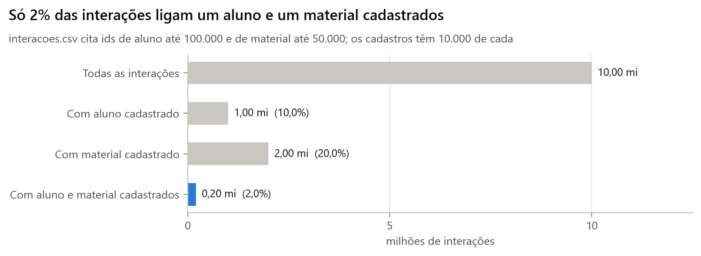{#fig-integridade width=100%}



**Decisão:** nenhuma interação foi descartada. A filtragem colaborativa só precisa de ids, então usa todas as 10 milhões; os modelos de conteúdo e de conhecimento usam apenas o que tem cadastro; e só materiais cadastrados são recomendados, porque um material sem título não pode ser exibido. Alunos sem cadastro continuam atendidos pelo histórico (ver as regras de troca na @sec-hibrido).

## Catálogo e perfis replicados

Os 10.000 materiais são **10 obras distintas**, cada uma repetida 1.000 vezes com ids diferentes (@tbl-obras), e os 10.000 alunos são **8 perfis** repetidos 1.250 vezes (@tbl-perfis). Para o modelo de conteúdo, as 1.000 cópias de uma obra são indistinguíveis; só o histórico pode diferenciá-las. Por isso as métricas são reportadas em dois níveis: por material (o item recomendado) e por obra (o que o aluno percebe).





As abreviações dos perfis foram normalizadas antes do uso — "BD" e "Banco de Dados" aparecem como disciplinas distintas no arquivo, assim como "IA", "ML", "SO", "PM", "QA" e "SI".

## Ausência de sinal nas interações

Todas as colunas de `interacoes.csv` seguem distribuições uniformes (@fig-distribuicoes): 20% de cada nota, 50% de cada tipo, durações uniformes entre 5 e 240 minutos e datas uniformes ao longo de 2023. Isso por si só não impede a recomendação; o que impede é a independência entre a nota e tudo o mais (@tbl-testes):

- **Não há efeito de aluno nem de material.** Na ANOVA com 100 mil grupos, F =  (p = ); com 50 mil materiais, F = . A fração da variância explicada (η² =  e ) é exatamente a esperada por acaso para esse número de grupos.
- **O passado não prevê o futuro.** A correlação entre a nota média de um aluno no 1º e no 2º semestre é r = ; para materiais, r =  (@fig-estabilidade). Um recomendador aprende justamente essa estabilidade.
- **O perfil não interage com o conteúdo.** A nota média de cada combinação perfil × obra fica entre 2,94 e 3,06 (@fig-perfil-obra), com F =  e p =  na ANOVA, e a escolha da obra também independe do perfil.
- **Até as repetições são aleatórias.** Há  pares aluno-material repetidos, contra  esperados num sorteio uniforme.

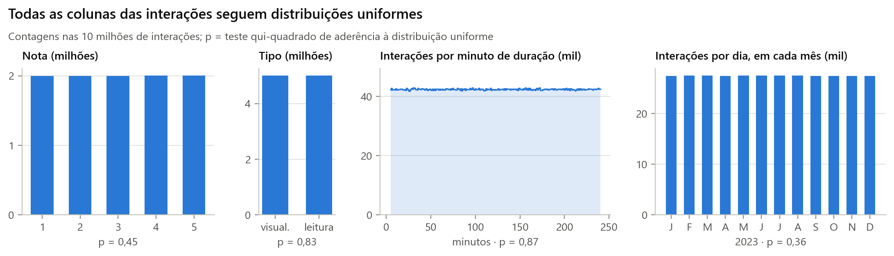{#fig-distribuicoes width=100%}

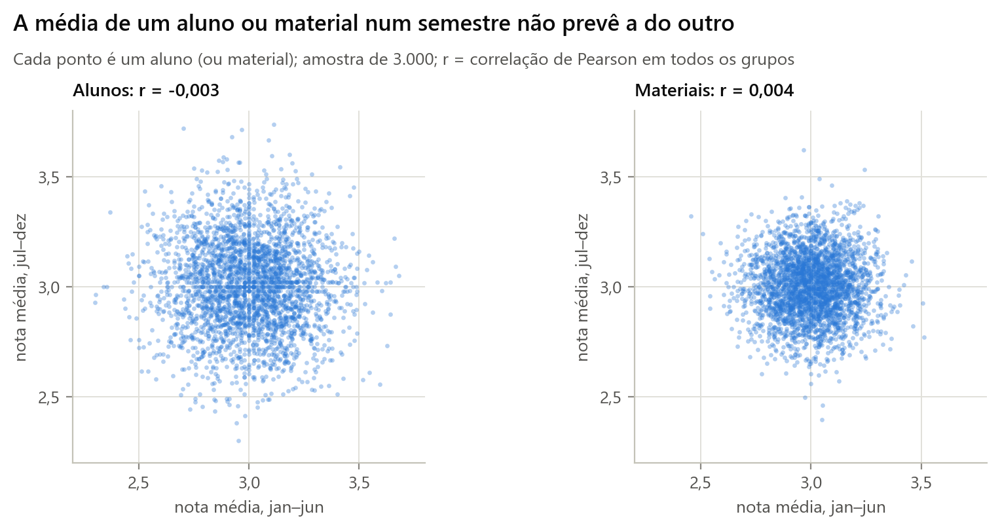{#fig-estabilidade width=85%}

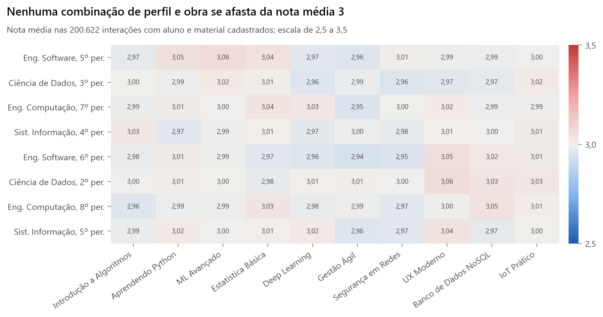{#fig-perfil-obra width=100%}



Com 10 milhões de linhas, esses testes detectariam efeitos minúsculos; não os detectaram. **Conclusão:** as interações são estatisticamente indistinguíveis de ruído uniforme, e nenhum modelo — por melhor que seja — pode superar o acaso nelas. O relatório trata isso como resultado, não como falha: a @sec-real mostra que todos os modelos empatam com o acaso, e a @sec-controlado valida a implementação num cenário em que existe sinal conhecido.

# Arquitetura do sistema {#sec-arquitetura}

O sistema é um pacote Python (`recomendador/`) com módulos independentes por responsabilidade, orquestrado por `pipeline.py` e exposto pela demonstração `app.py` (@fig-arquitetura).

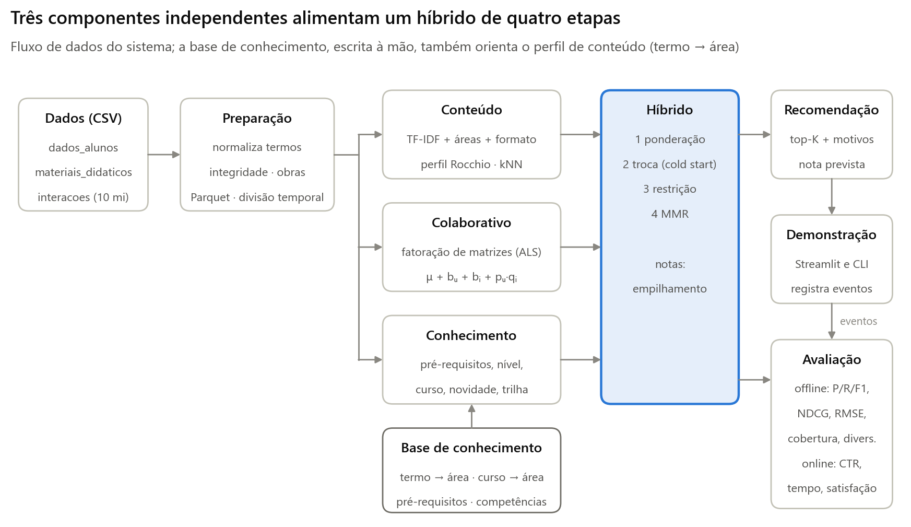{#fig-arquitetura width=100%}

| Módulo | Responsabilidade |
| :------------------------- | :--------------------------------------------------------------------- |
| `dados.py` | Leitura em blocos de 2 milhões de linhas com tipos compactos (160 MB em memória), cache Parquet, normalização de termos, identificação de obras e perfis, divisão temporal |
| `analise.py` | Integridade referencial e os 13 testes estatísticos da @sec-dados |
| `ontologia.py` | Base de conhecimento escrita à mão: termo → área, curso → área, pré-requisitos e competências de cada obra |
| `modelos/` | Um recomendador por arquivo, todos com a mesma interface: `treinar`, `pontuar`, `prever_avaliacao`, `recomendar` |
| `avaliacao.py`, `experimentos.py` | Protocolo offline, métricas, intervalos de confiança, ajuste na validação |
| `simulacao.py` | Cenário com sinal controlado e teste A/B simulado |
| `online.py` | Registro de eventos da demonstração e cálculo de CTR, engajamento e satisfação |
| `figuras.py`, `relatorio.py` | Figuras e tabelas deste relatório, geradas a partir dos resultados |

: Módulos do pacote `recomendador` {#tbl-modulos}

Uma recomendação percorre estes passos:

1. Carrega o perfil (se houver) e o histórico do aluno.
2. Cada componente pontua os 10.000 materiais candidatos.
3. As pontuações são normalizadas para [0, 1] por aluno e somadas com os **pesos efetivos** daquele aluno (regras de troca).
4. Materiais cujos pré-requisitos o aluno não cumpre perdem uma penalidade fixa.
5. O MMR escolhe os K itens finais equilibrando relevância e variedade; materiais já vistos são excluídos.
6. Cada item sai com suas justificativas (regras disparadas, termos e área em comum, nota prevista).
7. Na demonstração, impressões, cliques, tempo de estudo e satisfação são registrados para as métricas online.

**Decisões de projeto.** Todas as operações pesadas são vetorizadas com matrizes esparsas: a filtragem colaborativa treina sobre 8,3 milhões de avaliações em segundos por iteração, e as pontuações são calculadas em lotes de 500 alunos × 10.000 materiais. A base de conhecimento é código, não dados aprendidos — isso torna as regras auditáveis e permite recomendar a quem não tem histórico. Todo o pipeline usa sementes fixas e é reproduzível com `python pipeline.py`.

# Modelos de recomendação

## Filtragem baseada em conteúdo

Cada material vira um vetor com três blocos, normalizados separadamente: **área** (one-hot nas 8 áreas), **formato** (tipo e nível, one-hot) e **texto** (TF-IDF de título e descrição, sem acentos, sem *stopwords* e com remoção do plural). A similaridade entre um perfil *p* e um material *x* é a média ponderada do cosseno de cada bloco:

$$ s_{\text{cont}}(u, i) = \sum_{b} w_b \cos\left(p_u^{b},\, x_i^{b}\right), \qquad b \in \{\text{área},\ \text{formato},\ \text{texto}\} $$

com pesos 0,5 para área, 0,2 para formato e 0,3 para texto.

O perfil do aluno soma duas partes no mesmo espaço:

- **declarada:** interesses (peso 1) e disciplinas (peso 0,6) projetados nas áreas pela ontologia — "Deep Learning" → IA, "Analytics" → Estatística — mais o TF-IDF desses termos;
- **histórica (Rocchio):** a média dos vetores dos materiais avaliados, com peso (nota − 3)/2, positiva para notas 4–5 e negativa para 1–2.

$$ p_u = \hat d_u + \frac{n_u}{n_u + 5}\,\hat h_u, \qquad h_u = \sum_{j} \frac{r_{uj} - 3}{2}\, x_j $$

em que $d_u$ é o perfil declarado, o acento circunflexo indica normalização (norma 1) e $n_u$ é o tamanho do histórico. Assim, um aluno novo é descrito só pelo que declarou, e o histórico ganha peso à medida que cresce. Para prever notas, o componente usa um **kNN de conteúdo**: a nota prevista é o baseline $b_{ui} = \mu + b_u + b_i$ corrigido pelos resíduos que o aluno deu a materiais parecidos, com similaridade elevada ao quadrado e encolhimento:

$$ \hat r_{ui} = b_{ui} + \frac{\sum_j s_{ij}^2\,(r_{uj} - b_{uj})}{\sum_j s_{ij}^2 + 1} $$

## Filtragem colaborativa

Fatoração de matrizes com vieses (Koren, Bell e Volinsky, 2009):

$$ \hat r_{ui} = \mu + b_u + b_i + p_u^{\top} q_i, \qquad \min \sum_{(u,i)} \big(r_{ui} - \hat r_{ui}\big)^2 + \lambda\big(\lVert p_u\rVert^2 + \lVert q_i\rVert^2\big) + \lambda_b\big(b_u^2 + b_i^2\big) $$

com 8 fatores, $\lambda = 5$ e $\lambda_b = 10$. O treino é por **mínimos quadrados alternados** (ALS): com os materiais fixos, o vetor $[p_u, b_u]$ de cada aluno é a solução exata de uma regressão *ridge*; depois o mesmo para os materiais. A implementação é vetorizada — as matrizes de Gram de todos os alunos saem de um único produto esparso e os sistemas 9×9 são resolvidos em lote —, o que permite treinar sobre as 10 milhões de interações. A validação escolhe o número de iterações (parada antecipada com paciência 8, guardando a melhor iteração, porque a curva de validação do ALS pode piorar antes de melhorar; @fig-validacao-fc).

Alunos com vetores $p_u$ próximos têm padrões de avaliação parecidos: é assim que o modelo usa "usuários similares", e a demonstração mostra esses vizinhos. Uma primeira versão treinada por SGD ficou presa no nível dos vieses: nenhuma das 36 combinações de hiperparâmetros testadas tirou os fatores de perto de zero antes da parada antecipada, e o modelo recomendava os mesmos 13 materiais a todos. A troca pelo ALS baixou o RMSE de validação do cenário controlado de 1,130 para 1,074, elevou o NDCG@10 de 0,0014 para 0,0021 e a cobertura do catálogo de 0,1% para 11%. Regularização forte (λ ≥ 10) também colapsa os fatores, por isso λ = 5.

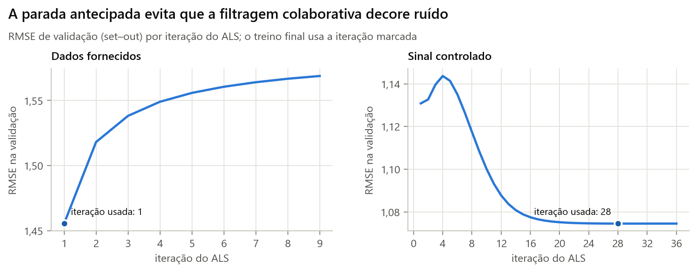{#fig-validacao-fc width=85%}

## Modelo baseado em conhecimento

A base de conhecimento (`ontologia.py`) define, para cada obra, os pré-requisitos e as competências que ela ensina (@tbl-obras), e para cada curso a relevância de cada área. As competências do aluno vêm das disciplinas cursadas (com implicações: cursar Python comprova base de Programação) e das obras concluídas no histórico (nota ≥ 3). Cinco regras são aplicadas a cada par aluno × obra:

1. **Pré-requisitos** — todos os grupos exigidos precisam ser atendidos; caso contrário a obra é inelegível (pontuação 0).
2. **Curso** — relevância curricular da área (ex.: IA vale 1,0 em Ciência de Dados e 0,3 em Sistemas de Informação).
3. **Nível** — 1,0 no nível esperado para o período (1º–2º: iniciante; 3º–5º: intermediário; 6º+: avançado), 0,6 um degrau acima ou abaixo, 0,2 dois degraus.
4. **Novidade** — obra introdutória de algo que o aluno já cursou é redundante.
5. **Desbloqueio** — obra que ensina um pré-requisito que falta para outra obra de uma área de interesse do aluno (trilha de aprendizagem).

$$ s_{\text{conh}}(u, w) = \text{elegível}(u, w) \times \left( \alpha_1\,\text{curso} + \alpha_2\,\text{nível} + \alpha_3\,\text{novidade} + \alpha_4\,\text{desbloqueio} \right) $$

com pesos 0,35 para curso e nível e 0,15 para novidade e desbloqueio.

Toda pontuação vem acompanhada das regras que a produziram. A saída abaixo, gerada pela demonstração de linha de comando sobre os dados fornecidos, mostra as cinco regras para o aluno 1 (Engenharia de Software, 5º período, interesse em Machine Learning). *ML Avançado* fica com pontuação zero porque falta Estatística, e por isso *Estatística Básica* ganha o bônus de trilha ("Desbloqueia: ML Avançado"); *Introdução a Algoritmos* perde o ponto de novidade porque o aluno já cursou Algoritmos; e as competências vindas do histórico (obras concluídas com nota ≥ 3) também contam como pré-requisitos atendidos.



## Hibridização {#sec-hibrido}

O híbrido combina as três pontuações em quatro etapas:

1. **Ponderação.** Cada componente é normalizado para [0, 1] por aluno (min-max) e somado com pesos $w_c$.
2. **Troca (cold start).** Os pesos mudam conforme o que se sabe do aluno: com menos de 5 interações, o peso colaborativo cai na proporção (com zero, some); sem perfil cadastrado, o peso de conhecimento é zero; sem perfil e sem histórico, o sistema recorre à popularidade. Os pesos são renormalizados para somar 1.
3. **Restrição.** Materiais inelegíveis perdem 0,5 ponto — continuam disponíveis se nada melhor existir, mas raramente entram na lista.
4. **Diversificação (MMR).** A lista é montada item a item, maximizando $\lambda\cdot\text{relevância} - (1-\lambda)\cdot\max_{j \in L} \text{sim}(i, j)$, com λ = 0,8 e similaridade de conteúdo. O MMR roda sobre todos os candidatos: com 1.000 cópias por obra, os 100 primeiros costumam ser a mesma obra e um corte prévio impediria a diversificação.

$$ s_{\text{híbr}}(u, i) = \sum_{c} w_c(u)\,\tilde s_c(u, i) - \pi \cdot \mathbb{1}[\,i \text{ inelegível para } u\,] $$

em que $\tilde s_c$ é a pontuação normalizada do componente $c$, $w_c(u)$ é o peso efetivo para o aluno e π = 0,5 é a penalidade.

Os pesos padrão (conteúdo 0,4; colaborativo 0,3; conhecimento 0,3) são substituídos pelo melhor ponto de uma grade de 36 combinações (passo 0,1, nenhum peso abaixo de 0,1) **somente se** a melhora de NDCG@10 na validação for significativa por *bootstrap* pareado entre alunos — caso contrário, a "melhor" combinação seria só ruído de amostragem. Para prever notas, o híbrido usa **empilhamento linear**: a nota é o baseline mais uma combinação dos desvios previstos pelos três componentes, com coeficientes estimados por mínimos quadrados na validação.

## Modelos de referência

Todo resultado é comparado com: **aleatório** (ordem sorteada), **popularidade** (mais avaliações positivas no treino), **média global** e **vieses** $\mu + b_u + b_i$ regularizados (para notas). No cenário controlado há ainda o **oráculo**, que ordena pela utilidade verdadeira do simulador e marca o teto alcançável.

# Metodologia de avaliação

**Divisão temporal.** Treino com janeiro–outubro de 2023 e teste com novembro–dezembro, como numa plataforma real (o modelo nunca vê o futuro). Dentro do treino, janeiro–agosto × setembro–outubro serve de validação para o número de iterações da filtragem colaborativa, os pesos do híbrido e os coeficientes do empilhamento; depois os modelos são retreinados em janeiro–outubro.

**Protocolo de ranqueamento.** São avaliados os alunos cadastrados com ao menos um material relevante no teste (nota ≥ 4). Os candidatos são os 10.000 materiais cadastrados, excluídos os já vistos no treino. As métricas são calculadas por aluno e promediadas:

$$ \text{P@K} = \frac{|L_K \cap R|}{K},\qquad \text{R@K} = \frac{|L_K \cap R|}{|R|},\qquad \text{F1@K} = \frac{2\,\bar P\,\bar R}{\bar P + \bar R},\qquad \text{NDCG@K} = \frac{1}{\text{IDCG}_K}\sum_{k=1}^{K}\frac{\mathbb{1}[L_k \in R]}{\log_2(k+1)} $$

em que $L_K$ é a lista recomendada, $R$ o conjunto relevante e $\bar P$, $\bar R$ as médias de P@K e R@K entre os alunos. No **nível de obra**, cada lista é convertida na ordem das obras (pela maior pontuação entre as cópias) e é relevante a obra de qualquer material relevante; usa-se K = 3.

**Catálogo.** Cobertura = fração dos materiais candidatos que aparecem em alguma lista top-10. Diversidade = média, por lista, de $1 - \cos$ de conteúdo entre os pares de itens (0 quando a lista só tem cópias da mesma obra).

**Notas.** RMSE e MAE sobre os pares do teste em que aluno e material estão cadastrados (comuns a todos os modelos) e, para os modelos que não dependem de cadastro, sobre todo o teste.

**Incerteza.** Intervalos de confiança de 95% por *bootstrap* (1.000 reamostragens de alunos).

**Dois cenários.** Como os dados fornecidos não têm sinal, os mesmos modelos e o mesmo protocolo foram aplicados a um **cenário com sinal controlado** (`simulacao.py`): os mesmos 10.000 alunos e 10.000 materiais, com ~250 mil interações geradas a partir de uma utilidade desconhecida pelos modelos,

$$ u(a, m) = \beta_1\,\text{tópico} + \beta_2\,\text{adequação} + \beta_3\,\text{latente} + \beta_4\,\text{qualidade} $$

com pesos 1,0; 0,8; 0,8 e 0,4, cada termo padronizado antes da soma. Nela, *tópico* é o gosto do perfil pela área da obra (70% vindo dos interesses declarados, 30% idiossincrasia sorteada por perfil), *adequação* reúne pré-requisitos, nível e redundância, *latente* é o produto de vetores aleatórios de aluno e material (gosto individual que nenhum metadado explica) e *qualidade* é um viés por material. Cada aluno faz cerca de 25 interações; 70% escolhidas com probabilidade proporcional a $e^{u}$ e 30% ao acaso; a nota é 3 + 1,1·z(u) + viés do aluno + ruído, arredondada e limitada a 1–5, em que z(u) é a utilidade padronizada. O cenário não prova qual componente venceria com dados reais — o simulador assume, por exemplo, que interesses declarados e pré-requisitos importam. Ele verifica que cada componente captura o tipo de sinal para o qual foi projetado e que o híbrido os combina.

# Resultados nos dados fornecidos {#sec-real}

Foram avaliados  alunos, com  interações de treino e  de teste. Como previsto pela @sec-dados, **nenhum modelo se distingue do aleatório**: todos os intervalos de confiança se sobrepõem ao dele em NDCG@10 e em precisão por obra (@fig-real, @tbl-real).

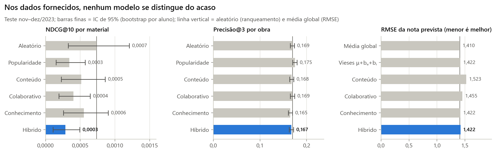{#fig-real width=100%}





Intervalos que se sobrepõem não bastam para afirmar empate, por isso o híbrido foi comparado com cada modelo aluno a aluno, por *bootstrap* pareado (@tbl-real-comparacoes). Das  diferenças,  passam do limiar de 5% isoladamente (menor p = ), ambas com o híbrido abaixo do outro modelo ( de NDCG@10 frente ao aleatório e  de precisão por obra frente à popularidade). Isso é compatível com o acaso em  testes — espera-se meio falso positivo. Com a correção de Bonferroni (limiar ), nenhuma diferença é significativa.



Três observações confirmam que o sistema se comportou corretamente diante de ruído:

- **Na previsão de notas, nada supera a média global** (RMSE , praticamente √2 ≈ 1,414, o desvio-padrão de uma nota uniforme em 1–5). Os vieses por aluno e material (RMSE ) e o kNN de conteúdo pioram o erro: cada parâmetro estimado a partir de ruído só adiciona variância.
- **A validação protegeu os modelos.** A filtragem colaborativa parou na iteração  (@fig-validacao-fc), e a busca de pesos não encontrou combinação significativamente melhor que a padrão, que foi mantida (@tbl-pesos).
- **As diferenças de cobertura e diversidade são estruturais, não de acurácia.** Conteúdo e conhecimento dão a mesma pontuação às 1.000 cópias de uma obra e geram listas de uma obra só (diversidade ≈ 0). A cobertura alta do conteúdo (%) é artefato do desempate aleatório entre cópias idênticas: cada aluno recebe cópias diferentes da mesma obra. O MMR do híbrido eleva a diversidade para .



# Validação com sinal controlado {#sec-controlado}

Com sinal presente, os componentes se separam do acaso e o **híbrido supera cada um deles** (@fig-controlado, @tbl-controlado). O oráculo mostra o teto: mesmo conhecendo a utilidade verdadeira, a precisão por material é baixa, porque cada aluno tem poucos itens relevantes entre 10.000 candidatos e a escolha simulada tem um componente aleatório.

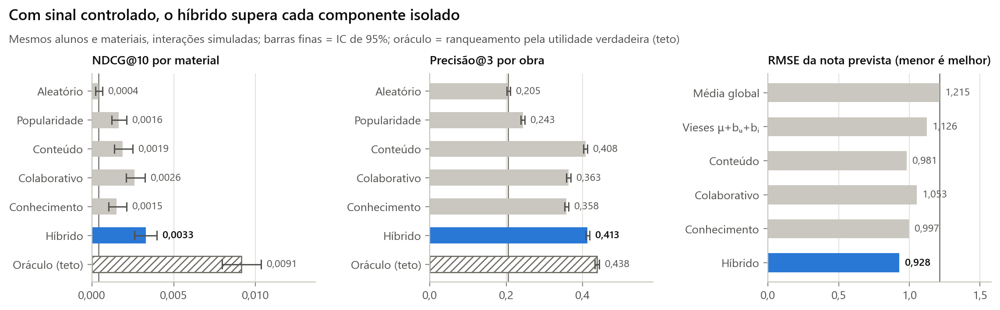{#fig-controlado width=100%}





As comparações pareadas confirmam que a vantagem não é ruído: o híbrido supera cada um dos cinco modelos nas duas métricas, nas  de  comparações, todas com p ≤  — inclusive o colaborativo em NDCG@10 (; IC ) e o conteúdo na precisão por obra (; IC ).



Cada componente capturou o sinal para o qual foi projetado:

- **Conteúdo** é o melhor componente isolado no nível de obra (precisão@3 de ): identifica as áreas de que o perfil gosta, mas recomenda dez cópias da mesma obra (diversidade ).
- **Conhecimento** acerta obras adequadas ao momento acadêmico (precisão@3 de ) e funciona sem nenhum histórico.
- **Colaborativo** é o melhor componente isolado no nível de material (NDCG@10 de ), porque é o único que distingue cópias da mesma obra — pelo gosto latente de cada aluno e pela qualidade de cada material. No nível de obra fica atrás de conteúdo e conhecimento (precisão@3 de ): não sabe que as 1.000 cópias são a mesma obra e precisa inferir isso de cerca de 20 avaliações por material.
- **Híbrido** junta o melhor de cada um: NDCG@10 de  (% acima do melhor componente, o , e  vezes o aleatório), a maior precisão por obra () e o menor RMSE (, contra  da média global), com diversidade de .

**Cold start.** Para 2.000 alunos sorteados, todo o histórico de treino foi apagado e os modelos foram retreinados sem eles (@fig-cold, @tbl-cold). A filtragem colaborativa não tem o que aprender desses alunos; o híbrido, pelas regras de troca, passa a usar só conteúdo e conhecimento e mantém a precisão por obra.

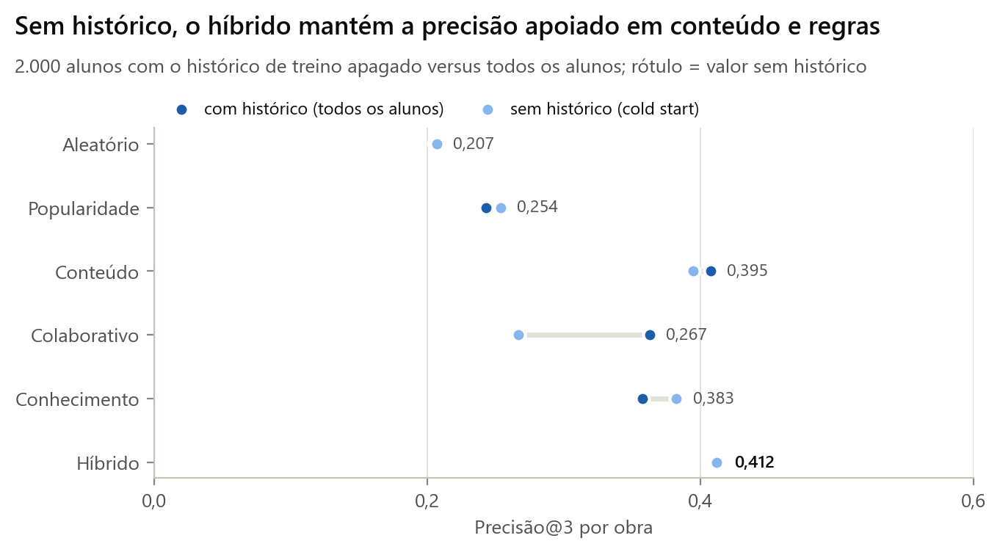{#fig-cold width=85%}



**Diversidade × precisão.** O λ do MMR controla a troca entre relevância e variedade (@fig-mmr, @tbl-mmr). O valor adotado, 0,8, multiplica a diversidade por  (de  para ) ao custo de % do NDCG@10; abaixo dele a perda acelera (com λ = , %). Uma plataforma real calibraria λ com o teste A/B, porque o efeito da diversidade na satisfação não aparece nas métricas offline.

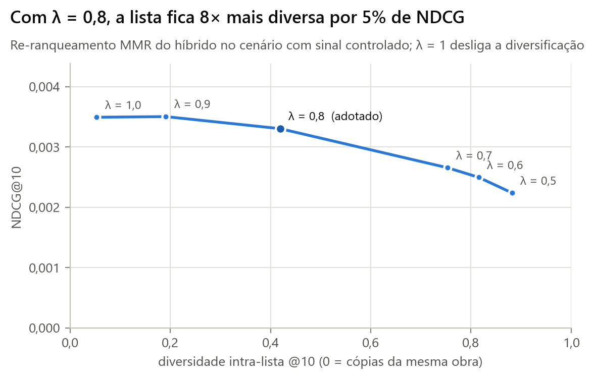{#fig-mmr width=80%}



# Métricas online

Métricas online exigem usuários reais interagindo com o sistema. O projeto implementa a instrumentação e mede as três métricas pedidas de duas formas.

**Na demonstração.** Cada lista exibida registra uma *impressão* por item; "Abrir material" registra um *clique*; "Concluí" registra os *minutos de estudo*; e as estrelas registram a *pesquisa de satisfação* (1–5). Os eventos vão para `artefatos/eventos_online.csv` e a aba "Métricas online" calcula, por modelo:

$$ \text{CTR} = \frac{\text{cliques}}{\text{impressões}}, \qquad \text{engajamento} = \frac{\text{minutos registrados}}{\text{sessões}}, \qquad \text{satisfação} = \text{média das respostas} $$

No modo "Teste A/B", cada sessão recebe um modelo sorteado, que é o desenho de um experimento controlado real.

**Teste A/B simulado.** Para comparar os modelos sem usuários reais, alunos simulados do cenário controlado receberam  sessões por modelo, com 10 recomendações cada. O aluno simulado examina a posição *k* com probabilidade $1/\log_2(k+1)$, clica com probabilidade crescente na utilidade verdadeira do item, gera minutos de estudo proporcionais a ela e responde à pesquisa (30% das sessões) com uma nota que sobe com a utilidade média dos itens examinados e com a variedade de obras da lista (@fig-online, @tbl-ab).

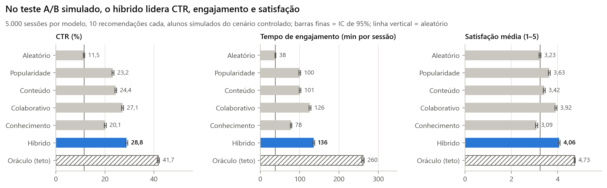{#fig-online width=100%}



O híbrido teve CTR de %,  minutos por sessão e satisfação  — à frente do segundo colocado, o colaborativo (%,  minutos e ), sem sobreposição dos intervalos de confiança. Conteúdo e conhecimento têm CTR razoável, mas as menores satisfações entre os modelos personalizados: suas listas repetem uma única obra, e o aluno simulado valoriza variedade. Esses números dependem das hipóteses do aluno simulado; o protocolo de um teste real está nas sugestões de melhoria.

# Análise de pontos fortes e fracos

**Pontos fortes**

- **Robusto ao cold start.** Conteúdo e regras funcionam sem histórico, e as regras de troca redistribuem os pesos automaticamente; alunos sem cadastro continuam atendidos pelo histórico.
- **Explicável.** Cada recomendação traz as regras disparadas, a área e os termos em comum e a nota prevista — importante num contexto educacional, em que o aluno precisa confiar na sugestão.
- **Respeita requisitos acadêmicos.** O sistema não recomenda *ML Avançado* a quem não tem os pré-requisitos e indica a obra que os desbloqueia.
- **Escala.** Leitura em blocos, tipos compactos e álgebra esparsa processam as 10 milhões de interações num computador pessoal.
- **Avaliação honesta.** Divisão temporal, validação separada do teste, intervalos de confiança, um critério de significância para os pesos e um teto (oráculo) contra o qual medir.
- **Reprodutível e testado.** Um comando gera todos os resultados e este relatório; testes automatizados cobrem métricas, regras e modelos.

**Pontos fracos**

- **Os dados fornecidos não permitem avaliar a qualidade real.** Todos os ganhos medidos vêm do cenário simulado, cujas hipóteses favorecem os sinais que o sistema sabe usar.
- **Base de conhecimento manual.** Pré-requisitos, relevância curricular e o mapa termo → área foram escritos à mão; precisam de revisão por especialistas e de manutenção a cada mudança de currículo.
- **Filtragem colaborativa dependente de densidade.** Com cerca de 20 avaliações por material, a filtragem colaborativa não descobre sozinha que as 1.000 cópias são a mesma obra (no nível de obra fica atrás de conteúdo e conhecimento), é sensível à regularização (forte demais, os fatores colapsam) e não tem o que oferecer a quem não tem histórico.
- **Conteúdo raso.** Título e descrição têm poucas palavras; o TF-IDF erra com ambiguidade ("Redes" de computadores × "redes neurais") e não distingue as 1.000 cópias de uma obra.
- **Pesos globais.** Os pesos do híbrido são os mesmos para todos os alunos (exceto pelas regras de troca); alunos diferentes poderiam se beneficiar de combinações diferentes.
- **Métricas online simuladas.** CTR, engajamento e satisfação foram medidos com usuários simulados; a instrumentação existe, mas não houve usuários reais.

# Sugestões de melhorias

**Dados**

- Corrigir a integridade referencial na origem e deduplicar o catálogo (uma obra com várias edições, não mil registros idênticos).
- Registrar sinais implícitos ricos — downloads, conclusão, retorno ao material, tempo de leitura real — e não só uma nota por interação.
- Enriquecer os metadados com ementa, palavras-chave e bibliografia das disciplinas.

**Modelos**

- Filtragem colaborativa para feedback implícito (ALS implícito ou BPR), que aprende com *quais* materiais o aluno escolhe e não só com a nota.
- *Embeddings* semânticos de texto (ex.: modelos de sentença em português) no lugar do TF-IDF, resolvendo sinônimos e ambiguidades.
- Pesos do híbrido aprendidos por *learning to rank* e personalizados por segmento de aluno.
- Base de conhecimento extraída dos planos de ensino (grafo de pré-requisitos das disciplinas) em vez de escrita à mão.
- Exploração com *bandits* contextuais para descobrir materiais novos e reduzir o viés de popularidade.

**Avaliação e produção**

- Teste A/B real: sortear o braço por aluno (não por sessão), definir CTR como métrica primária e satisfação e conclusão de materiais como secundárias, com métricas de proteção (tempo de carregamento, reclamações) e tamanho de amostra calculado antes do início.
- Métricas de novidade, serendipidade e equidade entre cursos.
- Servir o modelo por uma API (ex.: FastAPI) com pontuações pré-calculadas e monitoramento de desvio dos dados.

# Demonstração funcional

```bash
pip install -r requirements.txt
python pipeline.py        # treina e avalia (≈ 15 min); gera os modelos em artefatos/
streamlit run app.py      # abre a demonstração no navegador
```

A demonstração tem quatro abas:

- **Recomendações** — escolha o cenário (dados fornecidos ou sinal controlado), o aluno (um exemplo de cada perfil, ou qualquer id até 100.000, inclusive sem cadastro), o modelo e o tamanho da lista. Mostra o perfil, as competências adquiridas pelo histórico, o histórico resumido e a lista com "Por que este material?" (regras, conteúdo e nota prevista). Os pesos do híbrido, o λ do MMR e a penalidade podem ser ajustados ao vivo. Inclui os alunos de comportamento mais parecido segundo a filtragem colaborativa e a pesquisa de satisfação.
- **Métricas offline** — as tabelas e figuras deste relatório.
- **Métricas online** — CTR, minutos por sessão e satisfação calculados dos eventos registrados na própria demonstração, e o teste A/B simulado.
- **Qualidade dos dados** — os números e figuras da @sec-dados.

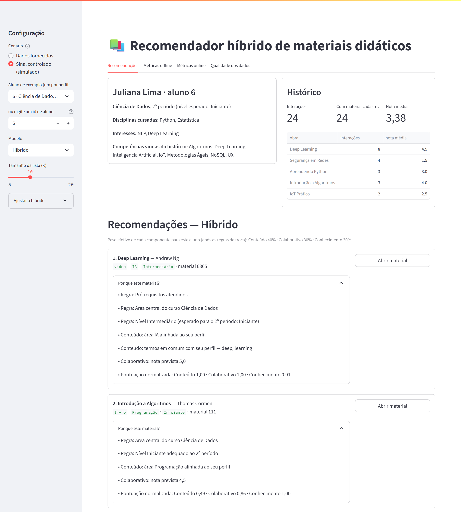{#fig-demo width=100%}

A configuração inicial também pode vir pela URL, o que permite compartilhar uma tela específica: `http://localhost:8501/?cenario=controlado&aluno=6&modelo=Híbrido`. Sem navegador, a mesma lógica está disponível na linha de comando:

```bash
python recomendar.py --aluno 2                       # top 10 do híbrido, com motivos
python recomendar.py --aluno 1 --regras --k 3        # regras para as 10 obras
python recomendar.py --aluno 6 --cenario controlado  # cenário com sinal
python recomendar.py --aluno 35000                   # aluno sem cadastro
```

# Conclusão

O sistema implementa as três abordagens pedidas e as combina num híbrido que pondera, troca pesos conforme o que se sabe do aluno, respeita pré-requisitos e diversifica a lista, explicando cada recomendação. A análise dos dados mostrou que as interações fornecidas são ruído uniforme, com 98% delas sem cadastro correspondente; nesse cenário, o resultado correto é o que se obteve — nenhum modelo supera o acaso, e a validação impediu que ruído fosse confundido com padrão. No cenário com sinal controlado, cada componente capturou o sinal que deveria e o híbrido superou todos eles em ranqueamento, previsão de notas e no teste A/B simulado. O próximo passo de maior impacto não é um modelo melhor, e sim dados melhores: integridade referencial, catálogo sem duplicatas e sinais implícitos de uso.

# Referências {.unnumbered}

- Burke, R. (2002). Hybrid recommender systems: survey and experiments. *User Modeling and User-Adapted Interaction*, 12(4), 331–370.
- Carbonell, J.; Goldstein, J. (1998). The use of MMR, diversity-based reranking for reordering documents and producing summaries. *SIGIR '98*.
- Cremonesi, P.; Koren, Y.; Turrin, R. (2010). Performance of recommender algorithms on top-N recommendation tasks. *RecSys '10*.
- Efron, B.; Tibshirani, R. (1993). *An Introduction to the Bootstrap*. Chapman & Hall.
- Felfernig, A.; Burke, R. (2008). Constraint-based recommender systems: technologies and research issues. *ICEC '08*.
- Herlocker, J. et al. (2004). Evaluating collaborative filtering recommender systems. *ACM TOIS*, 22(1), 5–53.
- Järvelin, K.; Kekäläinen, J. (2002). Cumulated gain-based evaluation of IR techniques. *ACM TOIS*, 20(4), 422–446.
- Kohavi, R.; Tang, D.; Xu, Y. (2020). *Trustworthy Online Controlled Experiments*. Cambridge University Press.
- Koren, Y.; Bell, R.; Volinsky, C. (2009). Matrix factorization techniques for recommender systems. *IEEE Computer*, 42(8), 30–37.
- Ricci, F.; Rokach, L.; Shapira, B. (orgs.) (2022). *Recommender Systems Handbook*. 3. ed. Springer.
- Rocchio, J. (1971). Relevance feedback in information retrieval. In: *The SMART Retrieval System*. Prentice-Hall.
- Zhou, Y. et al. (2008). Large-scale parallel collaborative filtering for the Netflix Prize. *AAIM 2008*.
- Ziegler, C.-N. et al. (2005). Improving recommendation lists through topic diversification. *WWW '05*.

# Apêndice A — Precisão, recall e F1 para K = 5, 10 e 20 {.unnumbered}





# Apêndice B — Reprodutibilidade {.unnumbered}

Todos os números deste relatório são gerados por `python pipeline.py` (sementes fixas em `recomendador/config.py`). As tabelas em `relatorio/tabelas/` e os valores citados no texto (`relatorio/variaveis.yml`) são reescritos a cada execução, e o documento é renderizado pelo Quarto em `.docx` e `.pdf`. Os resultados brutos ficam em `resultados/` (CSV e JSON) e os modelos treinados em `artefatos/`.
